# TrackLoop

Path-tracking controllers on a vehicle model, with stability analysis and system identification.

Status: version 1.0 (tag `v1.0-portfolio`). Everything here is simulation with placeholder vehicle parameters; nothing was run on a real vehicle.

## Overview

TrackLoop compares four path-tracking controllers (Pure Pursuit, Stanley, scheduled LQR with curvature feedforward, and linear MPC solved with OSQP) on kinematic and dynamic bicycle models, with paths from my own planners. It then asks three further questions: where do the linear closed-loop models of the controllers stop being valid, how well can the vehicle parameters be identified from noisy data, and does designing the controllers on the identified model remove the penalty of a wrong model. Every section below states its limits; the plant and the controllers' design model are usually the same simulated model, so the results check the algebra and the comparisons, not a real vehicle.

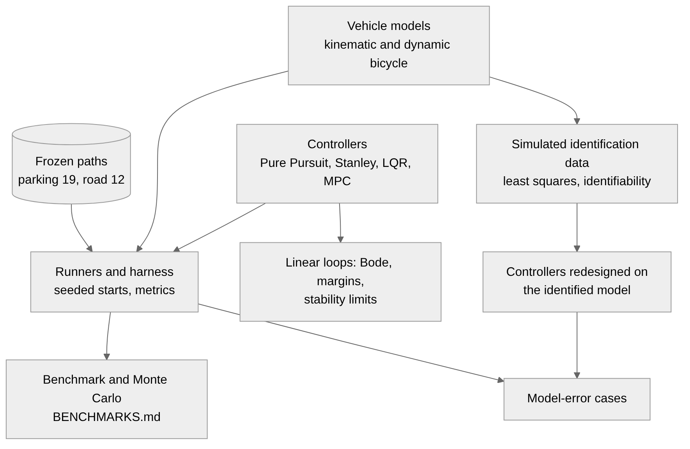

Code is in `src/trackloop/` (models, controllers, runners, metrics, analysis), one script per result in `scripts/`, tests in `tests/`, results in `data/results/`, figures in `docs/figures/`, and derivations in `docs/notes/`. Where each number comes from: [docs/TRACEABILITY.md](docs/TRACEABILITY.md). Failures, wrong hypotheses and open questions: [DEVLOG.md](DEVLOG.md).

## Main results

| Question | Result (simulation) | Section |
| --- | --- | --- |
| Road family, 20 m/s, mean RMS lateral error | LQR 0.045 m, MPC 0.054 m, Stanley 0.198 m, Pure Pursuit 0.257 m; LQR and MPC are partly outside the linear tire range | Monte Carlo benchmark (Task 16), `BENCHMARKS.md` |
| Parking family, 1.5 and 3 m/s | Pure Pursuit 0.084 and 0.109 m against 0.132 and 0.286 m for the kinematic LQR; cause not investigated | Monte Carlo benchmark (Task 16) |
| Phase margin at 10 m/s, 0.1 s steering lag | Pure Pursuit 33, Stanley 37, LQR 54, MPC 60 degrees | Gain and phase margins (Task 18) |
| Linear model against the simulation | within a few percent up to about a 0.25 m offset; the 0.8 rad/s steering rate limit explains the gap | Linearisation (Task 20) |
| Identification from simulated noisy data | cf, cr, Iz within 0.2 percent; mass is not identifiable | Tasks 21 to 23 |
| Wrong-model penalty, combined case, 20 m/s | LQR 2.6 times the nominal error, 1.4 with the identified model; MPC 2.8 and 1.6 | Controllers on the identified model (Task 24) |

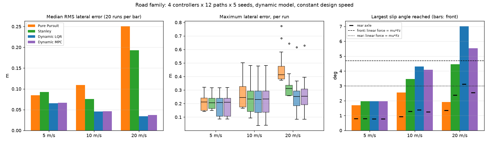

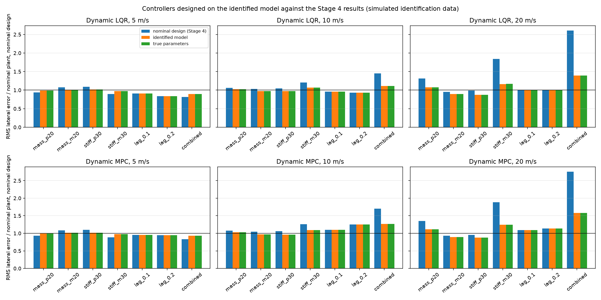

## Reproduce each stage

Run from the repository root after `pip install -e ".[dev]"`. One command per stage; the sections below list every script and the notes behind each number.

| Stage | Command | Writes |
| --- | --- | --- |
| 1 and 2: models and controllers | `python scripts/plot_recovery.py` | `docs/figures/lqr_vs_mpc_recovery.png` |
| 3: benchmark, parking family | `python scripts/run_benchmark_parking.py` | `data/results/benchmark_parking.csv` |
| 3: benchmark, road family | `python scripts/run_benchmark_road.py` | `data/results/benchmark_road.csv` |
| 3: Monte Carlo and `BENCHMARKS.md` | `python scripts/run_monte_carlo.py && python scripts/make_benchmarks_md.py` | `data/results/mc_*.csv`, `BENCHMARKS.md` |
| 4: model-error cases | `python scripts/run_model_error.py` | `data/results/model_error_*.csv` |
| 5: linear loops and margins | `python scripts/validate_linear_loops.py && python scripts/plot_margins.py` | `data/results/linear_loops_validation.csv`, `margins_vs_speed.csv` |
| 5: stability limits | `python scripts/check_stability_limits.py` | `data/results/stability_limits.csv` |
| 5: where linearisation stops | `python scripts/linearization_limits.py` | `data/results/linearization_limits.csv` |
| 6: identification data and fit | `python scripts/make_sysid_data.py && python scripts/run_identification.py` | `data/sysid/`, `data/results/identification.csv` |
| 6: identification quality | `python scripts/study_identifiability.py` | `data/results/identifiability_*.csv` |
| 6: controllers on the identified model | `python scripts/run_identified_design.py` | `data/results/identified_design*.csv` |
| Tests | `python -m pytest -q` | |

The Monte Carlo run is the longest (34,560 runs); `scripts/study_identifiability.py` takes a few minutes. The planner export scripts need the thesis and MultiPlan repositories (see "Paths from my planners"); the exported paths are already committed in `data/paths/`.

## Tests and continuous integration

`python -m pytest -q` runs 360 tests in about 15 seconds. Besides the unit tests for each module there are three kinds of check on the whole project:

- **Closed-form model checks** (`tests/test_analytic_models.py`): the kinematic model drives a circle of radius L / tan(delta) and a constant-acceleration straight line; the dynamic model's steady-state yaw rate matches v delta / (L + K v^2) with its understeer gradient K at three speeds, is v delta / L at any speed when the vehicle is neutral steer, and turns less (understeer) or more (oversteer) than the kinematic model.
- **Frozen regression runs** (`tests/test_regression_controllers.py`, `tests/reference_runs.json`): each of the four controllers on two road paths and two parking paths, seed 0. A change that moves RMS lateral error, maximum lateral error or steering effort by more than 0.5 percent fails the test; the same runs are checked against the committed benchmark CSVs, so the README numbers trace to the code. If a change is intended, regenerate the reference file and record why in the DEVLOG.
- **README check** (`tests/test_readme.py`): every file the README names exists.

GitHub Actions (`.github/workflows/ci.yml`) installs the package and runs the same command on every push to `main` and every pull request, on Python 3.12 only; I have not tested other Python versions.

## Stages 1 and 2: models and controllers

Kinematic and dynamic bicycle models, and four tracking controllers (Pure Pursuit, Stanley, scheduled LQR with curvature feedforward, and linear MPC solved with OSQP). The early results below were written before the later stages.

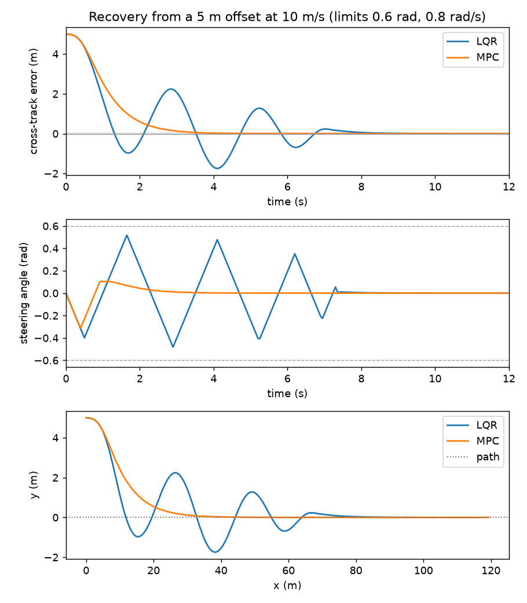

Recovery from a 5 m offset at 10 m/s on a straight path, with the plant limited to
0.6 rad steering and 0.8 rad/s steering rate. LQR is designed without the rate
limit and overshoots; MPC includes it and settles without overshoot. A 5 m offset
is far outside the small-error range LQR is linearized for, and the vehicle
parameters are placeholders, so this shows a limit of unconstrained LQR, not that
MPC is better in general. At 0.5 m and 2 m offsets the two settle at nearly the
same time (1.85 s vs 1.90 s, and 2.55 s vs 2.90 s).

Reproduce with `python scripts/plot_recovery.py`.

## Paths from my planners

Controllers are tested on paths from two planners, stored in one format: position, heading, curvature, arc length and a forward/reverse flag, sampled every 0.1 m.

**Thesis planner (Hybrid A*-RRT*, and Theta* with tightening).** The thesis code returns grid waypoints only, with no heading or curvature, so each corner is rounded with a circular arc (3 m per cell, 6 m radius). Ten paths: two planners on five random maps, 195 to 208 m long. The figure shows three of the five maps.

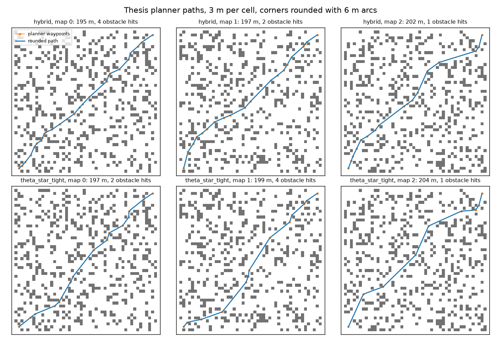

**Reeds-Shepp (from MultiPlan).** Nine paths from hand-chosen start and goal poses at a 5 m turning radius. Four of them reverse at least once, seven cusps in all. Blue is forward, orange is reverse, red crosses mark the cusps.

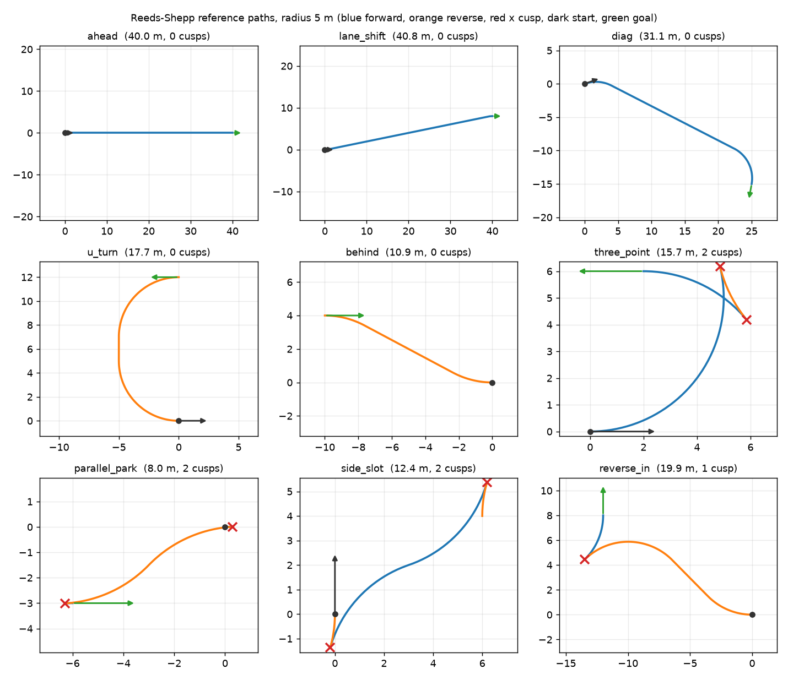

Limits:

- The rounded thesis paths are not collision-free: 9 of the 10 clip an obstacle when checked every 0.5 m (the arc cuts the corner by 0.21 to 1.13 m). They are reference paths for tracking tests, not planner results.
- Curvature jumps at the ends of arcs, and two paths on map 3 need curvature 0.294 and 0.279 against the placeholder car's limit of 0.253.
- Cell size, corner radius and car parameters are placeholders. Notes: `docs/notes/planner_export_math_reference.md` and `docs/notes/rs_export_math_reference.md`.

Reproduce: `python scripts/export_thesis_paths.py` (needs the thesis repo at `~/projects/hybrid-a-star-rrtstar-path-planning`), `python scripts/export_rs_paths.py` (needs MultiPlan at `~/projects/multiplan`), then `python scripts/plot_thesis_paths.py` and `python scripts/plot_rs_paths.py`.

## Tracking paths with cusps

Paths that reverse have cusps, where the car must stop and change gear. `segments.py` splits a path at its cusps, and `cusp_runner.py` tracks each single-gear segment with its own controller: settle the steering at a standstill, drive, brake to a stop at the cusp, repeat in the other gear. Pure Pursuit works unchanged in reverse, Stanley needs a reverse branch (its forward law diverges), and the LQR and MPC are rewritten on the kinematic model per metre driven, because the dynamic-model versions divide by speed.

Maximum cross-track error in metres on the four Reeds-Shepp paths with reverse driving (1.5 m/s, one run each, start on the path, no noise):

| path | Pure Pursuit | Stanley | Kinematic LQR | Kinematic MPC |
| --- | --- | --- | --- | --- |
| three_point | 0.135 | 0.669 | 0.024 | 0.025 |
| parallel_park | 0.319 | 0.991 | 1.007 | 1.007 |
| side_slot | 0.320 | 0.495 | 1.102 | 1.103 |
| reverse_in | 0.201 | 0.208 | 0.189 | 0.193 |

All 36 runs (four controllers, nine paths) finish and stop at every cusp. The 1 m errors of LQR and MPC on `parallel_park` and `side_slot` come from the path: it flips the steering curvature instantly, and the 0.8 rad/s steering limit cannot follow at 1.5 m/s (0.2 m at 0.5 m/s, 0.056 m with a 5 rad/s actuator).

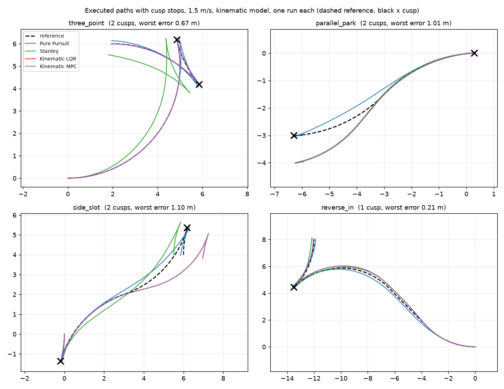

Limits: exploratory (one run per pair, no noise, the controllers' model is the simulated model); the Reeds-Shepp paths are not steering-rate feasible at 1.5 m/s; Stanley's weak forward-arc result is not diagnosed; the stop overshoots about 0.07 m; car and path parameters are placeholders. Notes: `docs/notes/cusp_tracking_math_reference.md`. Results: `data/results/cusp_tracking.csv`.

Reproduce: `python scripts/track_cusp_paths.py` (uses the exported paths in `data/paths`).

## Test set and feasibility

The benchmark test set is fixed before any benchmark run: every exported path (10 thesis, 9 Reeds-Shepp, 19 in all), with no path chosen or dropped by how a controller scores on it. `data/paths/manifest.json` records each path file's sha256, and a test fails if a file changes or a path is added or removed. The Reeds-Shepp paths were used while developing the cusp-tracking controllers, so they are development paths, not held-out ones.

`trackloop/feasibility.py` checks each path against the car's curvature limit (tan(0.6) / 2.7 = 0.2534 per metre) and its steering rate (0.8 rad/s). A curvature step the steering cannot follow at 1.5 m/s is an event, and its lag distance is the metres driven with the steering behind the path (0.93 m for a straight line into a 5 m arc, 1.86 m for a left-to-right flip).

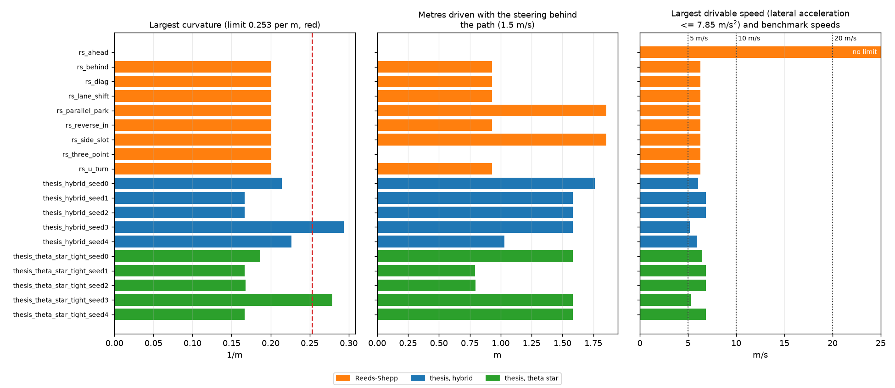

Result at 1.5 m/s: 2 of 19 paths pass both checks (`rs_ahead` and `rs_three_point`; no bar means zero lag). Only the two seed-3 thesis paths exceed the curvature limit (0.294 and 0.279). Every other path has curvature steps where a line meets an arc. Failing paths stay in the set and are flagged, not dropped.

Limits: placeholder car, one speed, a pure rate limiter, and lag distance measures what the path demands, not tracking error. Notes: `docs/notes/feasibility_math_reference.md`. Results: `data/results/feasibility.csv`.

Reproduce: `python scripts/build_testset_manifest.py`, `python scripts/check_testset_feasibility.py`, `python scripts/plot_feasibility.py`.

## Speed applicability

The benchmark speeds from the model validation are 5, 10 and 20 m/s, but at those speeds the frozen paths need far more lateral acceleration than tires give: a 5 m arc needs 5.0 m/s^2 at 5 m/s, 20 at 10 m/s and 80 at 20 m/s, against about 7.8 (mu = 0.8, a placeholder). Only the straight path is drivable at 10 and 20 m/s. So the 19 frozen paths are the parking family for low speeds, and a road family with paths scaled to each speed was exported and frozen before any benchmark run (see "Road family"). `scripts/speed_applicability.py` computes the table (`data/results/speed_applicability.csv`), and the figure above has a third panel for it.

## Metrics

All scores come from one definition (`src/trackloop/metrics.py`, `docs/notes/metrics_math_reference.md`): signed lateral error to the path polyline at the rear axle, heading error, steering effort, steering-rate RMS and max, steering chatter (rate reversals per second), driving and total time, and cusp position error and settle time. `scripts/score_cusp_runs.py` scores the 36 cusp runs (`data/results/cusp_metrics.csv`). Lateral error alone hides that Stanley chatters 3.6 times a second on average against about 0.33 for the other three.

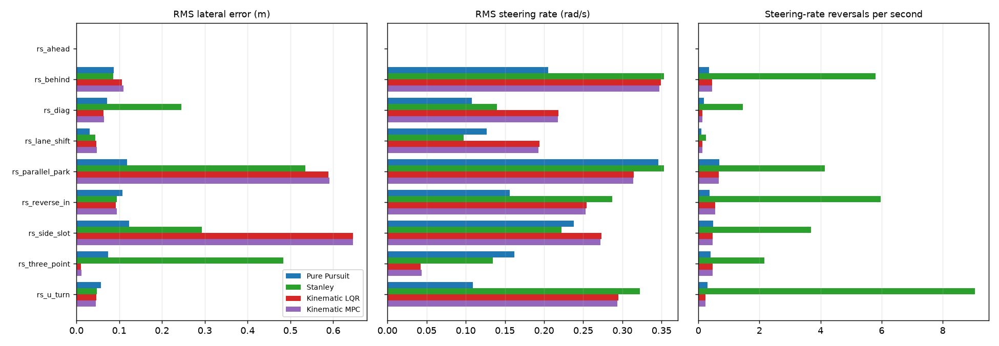

## Benchmark, parking family

`scripts/run_benchmark_parking.py` runs the four kinematic controllers on all 19 frozen paths at 0.5, 1.5 and 3.0 m/s with 5 seeds (1140 runs, `data/results/benchmark_parking.csv`). The seed sets the start offset and heading error, the same for every controller. Runs that break a limit are flagged, not dropped; the settings, git commit and package versions are saved with the results (`docs/notes/benchmark_design.md`). All runs finish. Kinematic LQR and MPC are indistinguishable (the plant is their own design model); at 3.0 m/s Pure Pursuit has the lowest median error on 18 of 19 paths, and LQR and MPC reach 1.0 to 1.5 m on the two tightest parking maneuvers. The cause is suspected, not shown. The road family with the dynamic controllers follows below.

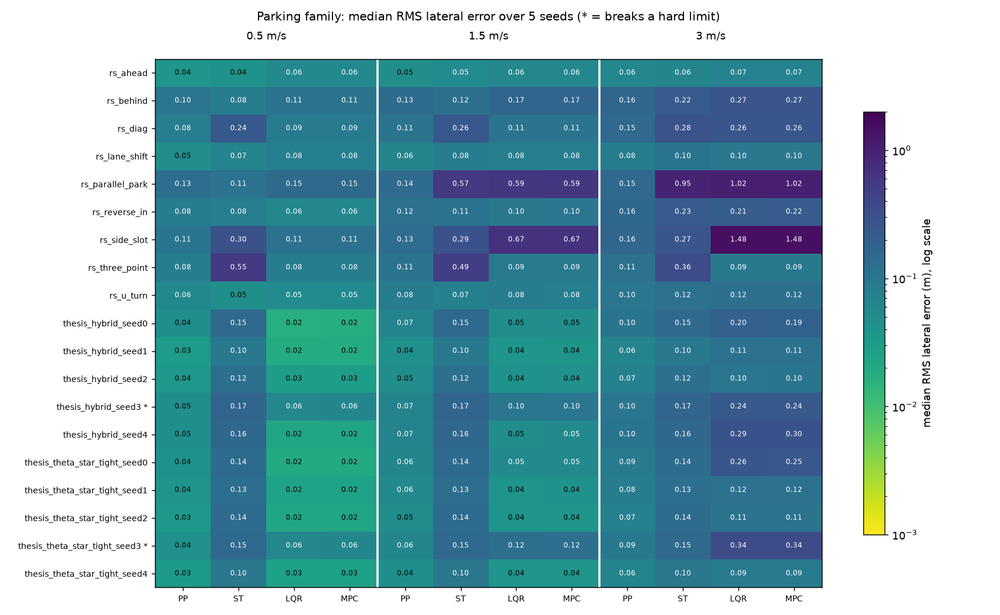

## Road family

The parking paths cannot be driven at the 5, 10 and 20 m/s benchmark speeds, so the road family has 12 forward paths sized to their speed: four shapes (curve, lateral shift, S-curve, double shift) at each speed, all with a peak lateral acceleration of 2.0 m/s^2 and a clothoid curvature ramp, so the steering never has to step. They are exported to `data/paths/road/` with a hashed manifest and frozen before any controller runs on them (`docs/notes/road_family_math_reference.md`). At 2.0 m/s^2 the tire slip angles are about 1 degree, inside the dynamic model's linear tire range.

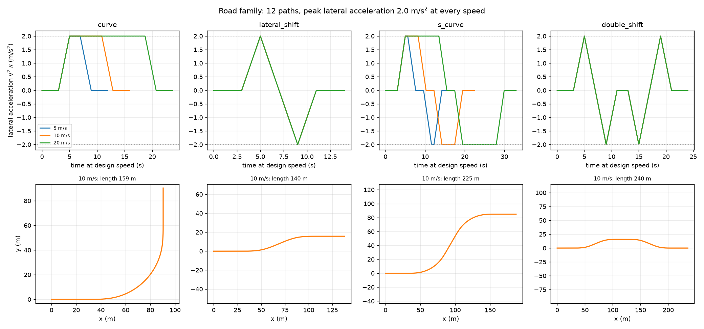

## Road-family benchmark (Task 14)

4 controllers on the dynamic model, 12 frozen road paths (5, 10, 20 m/s), 5 seeds, 240 runs, all
finished. At 5 m/s the controllers are indistinguishable; at 10 and 20 m/s the dynamic LQR and MPC
have lower median RMS lateral error, but at 20 m/s they leave the linear tire model's range
(front slip up to 7 deg against a 4.7 deg friction limit). See `docs/notes/benchmark_road_note.md`
and `docs/figures/benchmark_road.png`. Run it with `python scripts/run_benchmark_road.py`.

## Model-error cases (Task 15)

The controllers are designed on nominal parameters and the plant is changed: on the road family
(dynamic plant) mass +-20 percent, cornering stiffness +-30 percent, steering lag of 0.1 s and
0.2 s, and one combined case; on the parking family (kinematic plant) steering lag and wheelbase
+-5 percent, since that model has no mass or tire. The case sizes are placeholders. On the road,
more mass or softer tires raises the error and the effect grows with speed; the combined case is
worst (up to 2.8 times nominal for the dynamic MPC at 20 m/s). In parking only the kinematic MPC
is badly hurt by steering lag (about 7 times nominal at 3 m/s with 0.2 s lag). Five runs did not
finish (dynamic MPC, 20 m/s, 0.2 s lag). The causes of the worst of these are in `docs/notes/root_cause_note.md`. See
`docs/notes/model_error_note.md` and `docs/figures/model_error.png`. Run it with
`python scripts/run_model_error.py`.

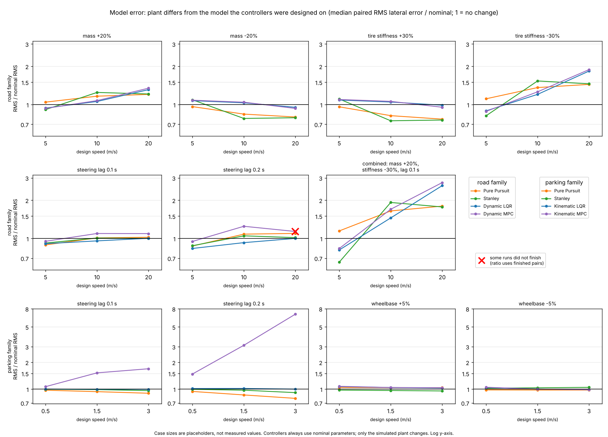

## Monte Carlo benchmark and root causes (Task 16)

The benchmark now runs 150 seeds on the road family and 120 on the parking family, sized so that
every cell's 95 percent interval is within 5 percent of its mean (largest achieved 4.9 percent;
34,560 runs, all finished). `BENCHMARKS.md` gives the means with intervals and the seed-by-seed
differences between controllers. On the road at 20 m/s the dynamic LQR (0.045 m) and MPC (0.054 m)
are well below Stanley (0.198 m) and Pure Pursuit (0.257 m); Pure Pursuit and Stanley were not
tuned for those speeds, and the LQR and MPC are partly outside the linear tire model's range
there. In parking, Pure Pursuit is below the kinematic LQR and MPC at 1.5 and 3 m/s (0.084 and
0.109 m against 0.132 and 0.286 m for the LQR); I have not investigated why.

The worst runs were traced in `docs/notes/root_cause_note.md`: both MPCs fail under steering lag
when their steering-rate bound is measured from the lagging steering angle (anchoring it to the
previous command removes the failures); Stanley's chatter at 5 m/s comes from the 0.1 m path
spacing and leaves the error unchanged; the worst start is driven by the heading error; and the
softer-tire cases push fewer runs past the tire friction limit, not more. The note lists what is
still unexplained. Run it with `python scripts/run_monte_carlo.py` and
`python scripts/make_benchmarks_md.py`.

## Linear closed-loop models (Task 17)

Each road controller is written as a linear system on a straight path, `delta_cmd = -K x`, with
error state `x = [lateral error, its rate, heading error, its rate]`, in `src/trackloop/linear_loops.py`
(python-control). Pure Pursuit and Stanley have closed-form gains; Dynamic LQR uses its gain schedule (Riccati gains on a speed grid, constant above 30 m/s);
Dynamic MPC uses the discrete LQR gain at the 0.05 s control period (equal to its first move while no
constraint is active; I derived that, and the simulation check below is the evidence). A first-order
steering lag adds the steering angle as a fifth state. All four loops are stable at 5, 10 and 20 m/s
without lag, and at 10 m/s with lags of 0, 0.1 and 0.2 s.

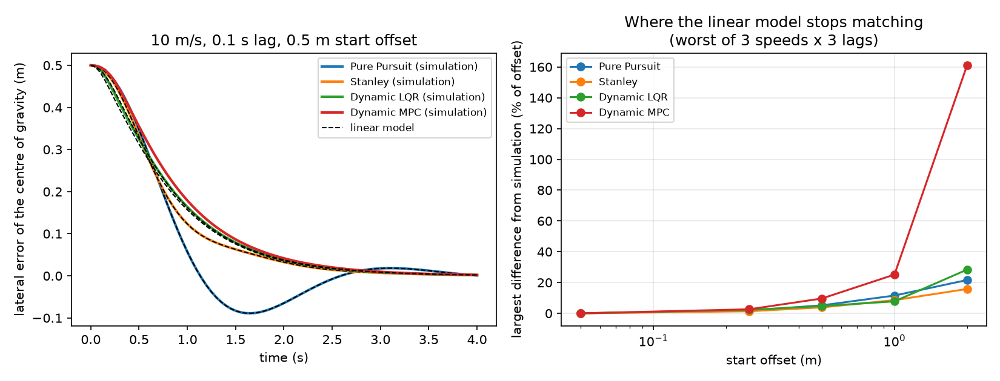

Against the nonlinear simulation (offset start, straight path, 4 s) the models agree to about 2e-5 m at a
0.05 m offset. The difference grows with the offset (worst case over 3 speeds and 3 lags: 22, 16, 28 and
161 percent of a 2 m offset for Pure Pursuit, Stanley, LQR and MPC). The steering rate limit explains it (Task 20).
The plant is the same model the equations came from, so this checks the algebra, not a real vehicle.
Details: [docs/notes/linear_loops_math_reference.md](docs/notes/linear_loops_math_reference.md).

## Gain and phase margins against speed (Task 18)

The Task 17 loops, broken at the steering command and sampled at 0.05 s, give a loop transfer function for each
controller (`src/trackloop/margins.py`). Gain margins come from scaling the loop gain and checking the poles;
phase margins from the frequency response at the unity-gain crossing. Phase margin falls with speed for all four
controllers and all three steering lags (0, 0.1, 0.2 s). At 10 m/s with a 0.1 s lag it is 33 degrees for Pure
Pursuit, 37 for Stanley, 54 for LQR and 60 for MPC.

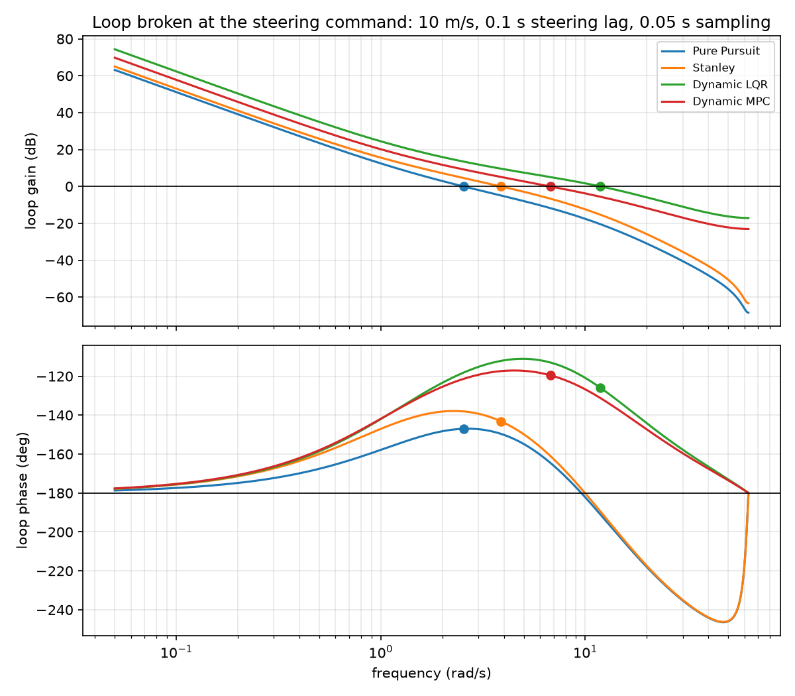

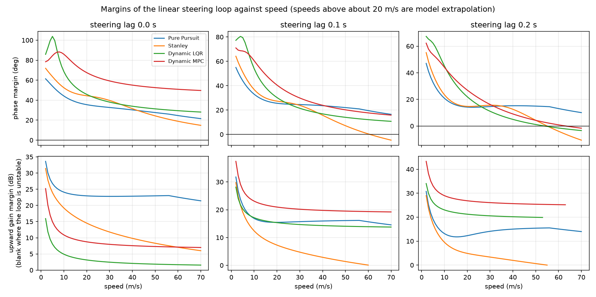

In this linear model the phase margin reaches zero only with a steering lag, and only at 56 to 64 m/s
(Stanley 61 m/s at 0.1 s lag; Stanley 56 and MPC 64 at 0.2 s lag; Pure Pursuit and LQR stay positive to 70 m/s).
The benchmark runs at most 20 m/s, so those speeds are an extrapolation of the linear tire model. Task 19 tests
them in the nonlinear simulation, and corrects the LQR numbers above 30 m/s (the first version of the model used a
gain the controller does not use there). The margins are to a change at the steering command, they leave out the steering
and rate limits, and for the MPC they use its unconstrained first move. Details in
[docs/notes/linear_loops_math_reference.md](docs/notes/linear_loops_math_reference.md).

## Where the linear loops lose stability, checked in the simulation (Task 19)

Lowest speed at which the sampled linear loop is unstable (`src/trackloop/stability_limit.py`):

| | no lag | lag 0.1 s | lag 0.2 s |
|---|---|---|---|
| Pure Pursuit | none to 300 m/s | 268.5 | 134.2 |
| Stanley | 166.7 | 60.7 | 55.0 |
| Dynamic LQR | none | none | 92.1 |
| Dynamic MPC | none | none | 63.2 |

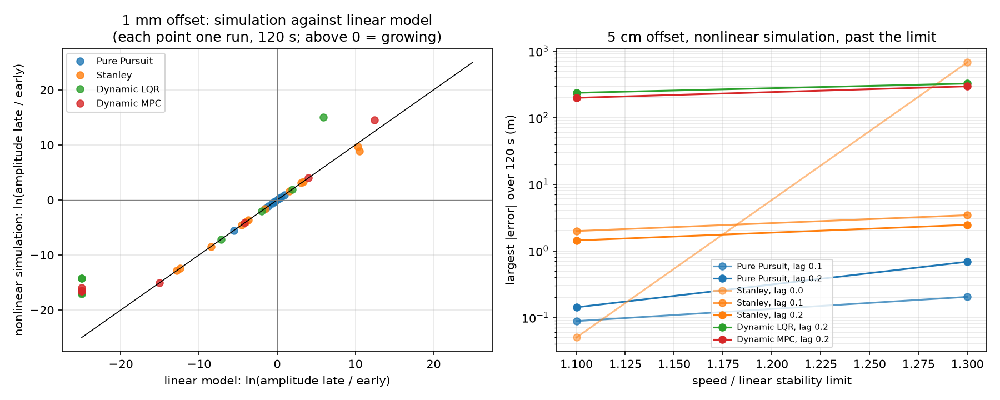

From a 1 mm offset, the nonlinear simulation grows or decays as the linear model says in 38 of 38 runs (0.9 to 1.1
times each limit, plus 100 and 300 m/s where there is none), so the instability appears at the predicted speed to
within 3 percent. The check found an error in my Task 18 model: the LQR controller holds its gain constant above 30 m/s
and I had used the exact gain, which put its limit at 54 m/s instead of 92 m/s. Fixed, and the Task 18 figures are
regenerated. Past the limit the simulation departs from the linear model (LQR and MPC grow faster than predicted; I
did not find why). Both sides use the same plant, so this checks the algebra, not a real vehicle, and the limits
(55 to 270 m/s) are far outside the 20 m/s benchmark. Details in
[docs/notes/linear_loops_math_reference.md](docs/notes/linear_loops_math_reference.md).

## Derivations and where linearisation stops being valid (Task 20)

The math note now derives the error model, the sampling and steering-lag model, the LQR and MPC gains and the
margins, each with a worked example at 10 m/s, and measures where the linear models stop matching the simulation.
The gap grows with the start offset, and almost all of it is the 0.8 rad/s steering rate limit, which a linear model
leaves out: with the rate limit removed from the plant (and, for the MPC, from its own constraints) the worst-case gap
at a 2 m offset falls from 16 to 161 percent to 0.4 to 2.6 percent.

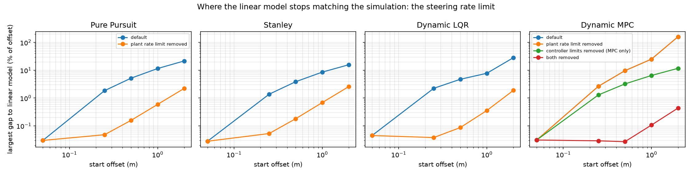

The linear models are good to a few percent up to about a 0.25 m offset. The steering angle limit is not the cause in
these runs. Tire saturation could not be tested: the simulation's tires are linear in slip angle, so the margins and
stability limits are optimistic about large manoeuvres. See
[docs/notes/linear_loops_math_reference.md](docs/notes/linear_loops_math_reference.md), part 6.

## Simulated identification data (Task 21)

Stage 6 starts with data to identify. `scripts/make_sysid_data.py` drives the dynamic model at 15 m/s with a steering
sweep (0.1 to 3 Hz) and with a random binary steering signal, and records yaw rate and lateral acceleration with
Gaussian noise (0.003 rad/s and 0.05 m/s^2). **This is simulated data**; it says nothing about identifying a real
vehicle.

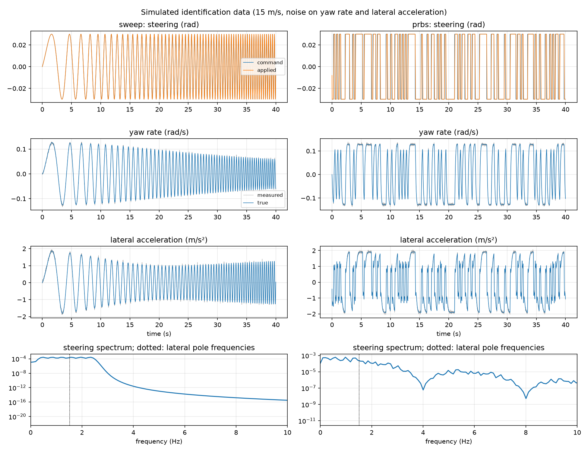

One result before any estimation: scaling mass, yaw inertia and both cornering stiffnesses by the same factor leaves
every measured signal unchanged (shown by derivation and by a test), so only cf/m, cr/m and Iz/m can be identified.
Task 22 therefore fixes the mass and estimates cf, cr and Iz. See
[docs/notes/linear_loops_math_reference.md](docs/notes/linear_loops_math_reference.md), "System identification data".

## Least-squares identification (Task 22)

`scripts/run_identification.py` estimates the front and rear cornering stiffnesses and the yaw inertia (cf, cr, Iz; the
mass is fixed because it is not identifiable) from the simulated noisy data by least squares on the prediction error, with
the parameter covariance from the Jacobian. Both estimates land within 0.2 percent of the true values, with standard
deviations of 0.11 to 0.21 percent, and over 100 noise seeds the predicted standard deviations match the real spread and the
95 percent intervals contain the true value in 93 to 97 percent of runs. The three estimates are strongly correlated (0.68 to
0.82).

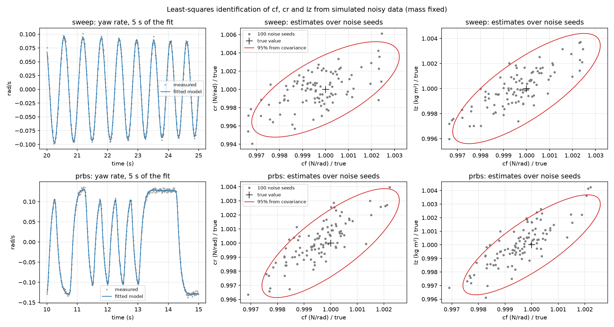

**Limit:** the fitted model is almost the model that generated the data and the noise levels are known, so this is a best
case; it says nothing about a real vehicle. See [docs/notes/linear_loops_math_reference.md](docs/notes/linear_loops_math_reference.md),
"Least-squares identification".

## Identification quality (Task 23)

`scripts/study_identifiability.py` varies the experiment and the assumptions behind the least-squares estimate (simulated data
only). Results: the standard deviation scales as noise / (amplitude x sqrt(length)); the rear stiffness is the poorly
identified parameter and needs speed (cr std 1.9 percent at 5 m/s, 0.2 percent at 15 m/s); a sweep that stops below the lateral
pole frequency or a random signal that switches slowly roughly doubles the intervals. The errors that matter are not the noise:
a wrong assumed mass moves all three estimates by exactly the same factor and the fit cannot tell (chi-squared unchanged), and
1 mrad of noise on the measured steering angle biases them down by 0.8 to 0.9 percent, several times the reported standard
deviation.

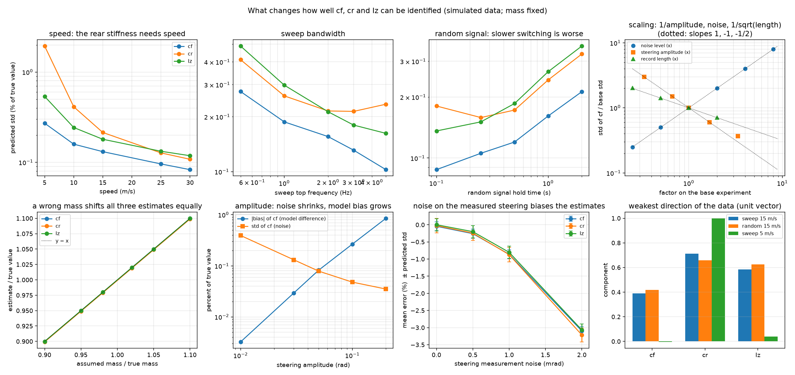

See [docs/notes/linear_loops_math_reference.md](docs/notes/linear_loops_math_reference.md), "Identification quality".

## Controllers on the identified model (Task 24)

`scripts/run_identified_design.py` closes the identification stage. For each Stage 4 model-error case a sweep experiment on the true
plant is fitted (simulated data, nominal mass assumed), and the LQR and MPC are designed on the identified model and on the true
parameters, then run on the plant. The identified design matches the true-parameter design to within 0.07 percent (median over 835 paired
runs, worst single run 0.5 percent), and removes the Stage 4 wrong-model penalty: at 20 m/s on the combined plant the LQR's RMS lateral
error goes from 2.6 times the nominal result to 1.4, the MPC's from 2.8 to 1.6. A wrong assumed mass makes no difference (only cf/m, cr/m
and Iz/m enter the design). Steering lag is not identified, so the lag cases are unchanged.

**Limit:** the identification data come from the same model as the plant, with exact steering measurement; this is a best case. See
[docs/notes/linear_loops_math_reference.md](docs/notes/linear_loops_math_reference.md), "Controllers designed on the identified model".

## License

MIT. See [LICENSE](LICENSE).
