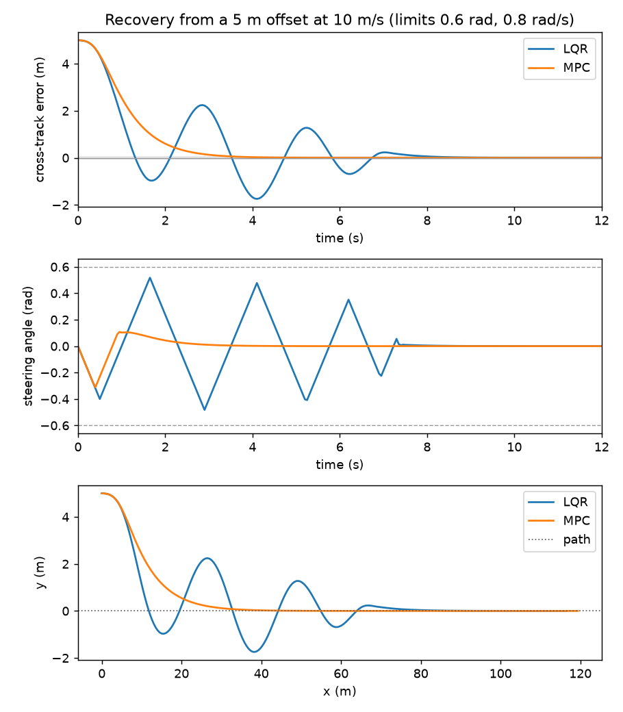

# TrackLoop

Path-tracking controllers on a vehicle model, with stability analysis and system identification.

Status: in progress.

## Current results

Stages 1 and 2 are done: kinematic and dynamic bicycle models, and four tracking
controllers (Pure Pursuit, Stanley, scheduled LQR with curvature feedforward, and
linear MPC solved with OSQP). Benchmarks, stability analysis and system
identification are still to come.

Recovery from a 5 m offset at 10 m/s on a straight path, with the plant limited to
0.6 rad steering and 0.8 rad/s steering rate. LQR is designed without the rate
limit and overshoots; MPC includes it and settles without overshoot. A 5 m offset
is far outside the small-error range LQR is linearized for, and the vehicle
parameters are placeholders, so this shows a limit of unconstrained LQR, not that
MPC is better in general. At 0.5 m and 2 m offsets the two settle at nearly the
same time (1.85 s vs 1.90 s, and 2.55 s vs 2.90 s).

Reproduce with `python scripts/plot_recovery.py`.
