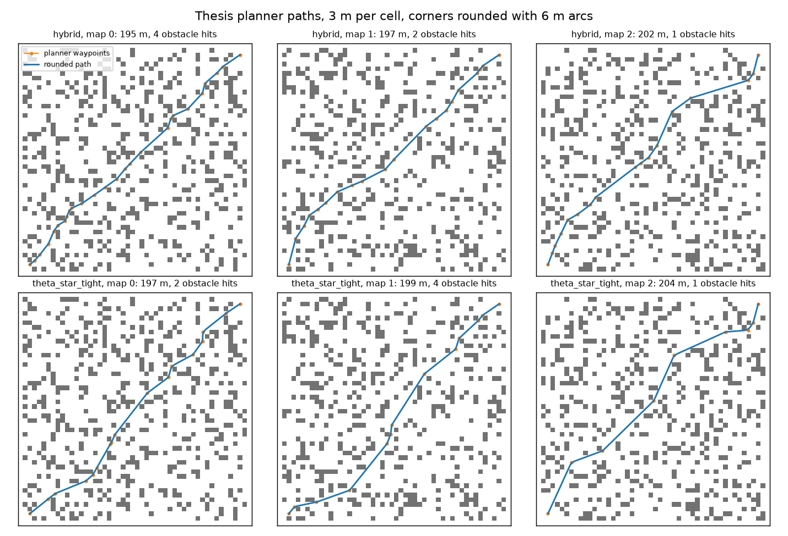
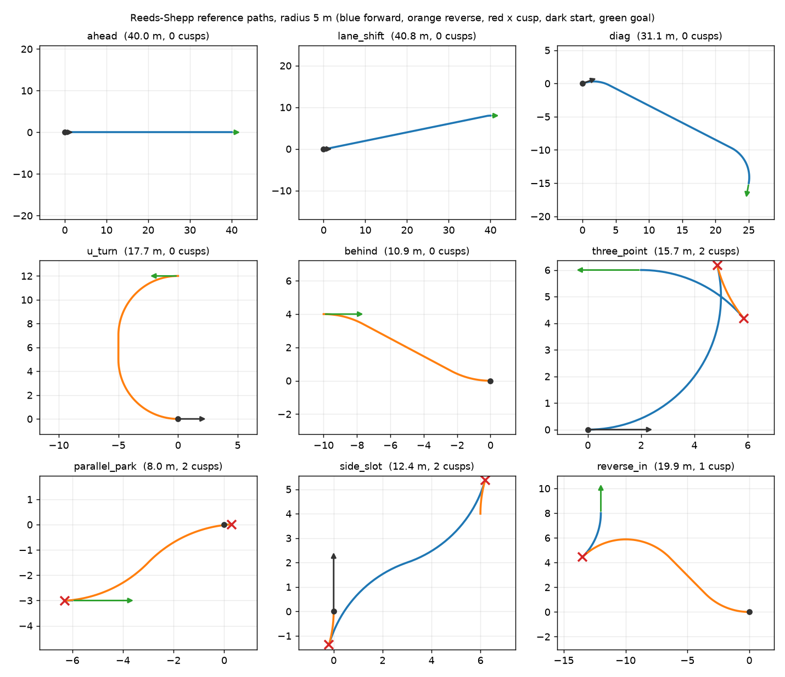
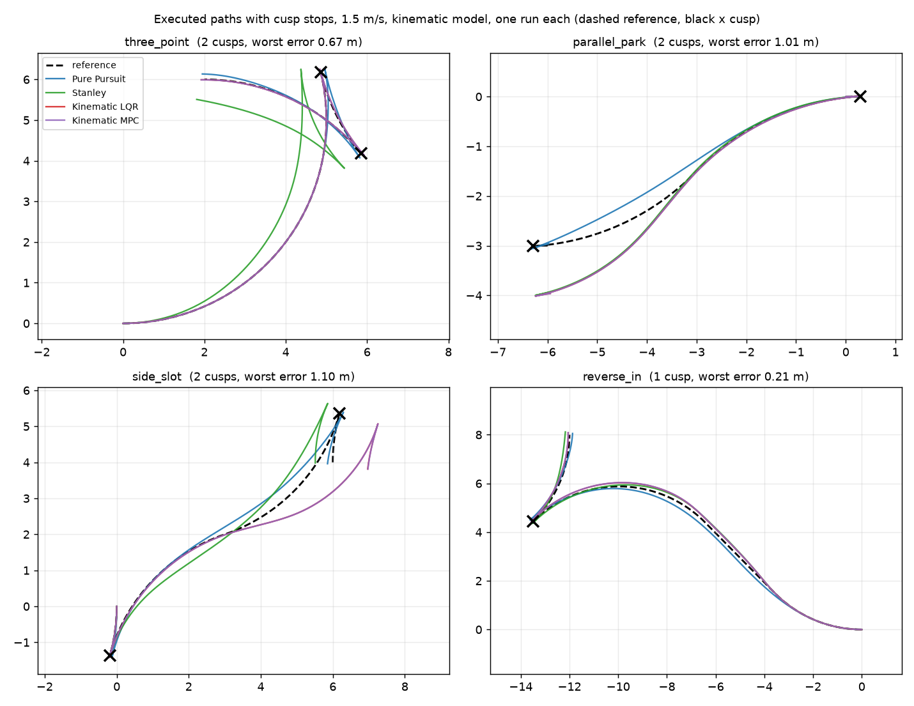
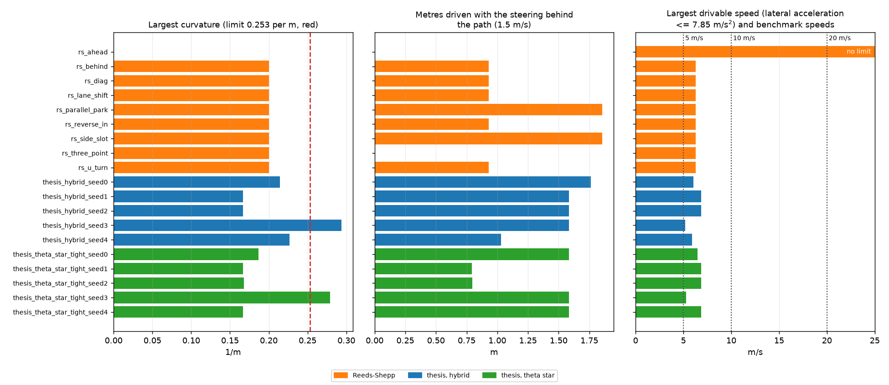
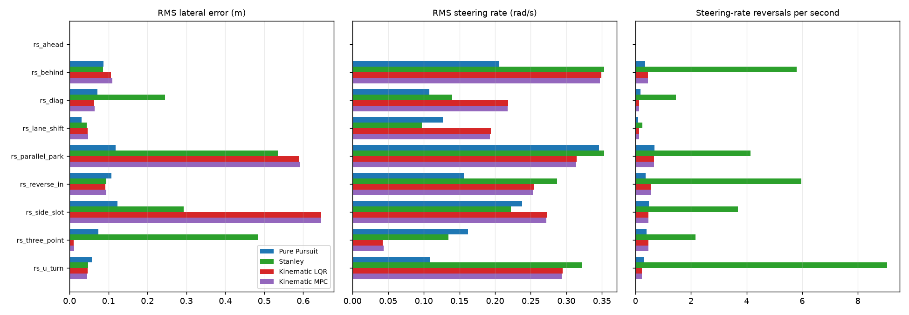
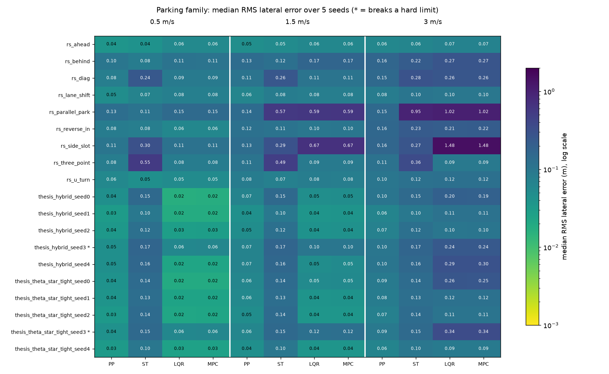
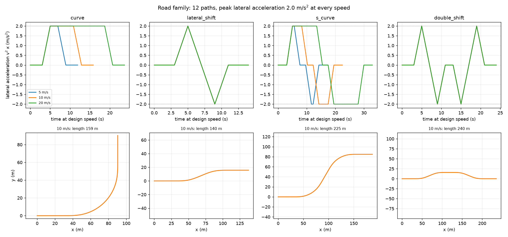

# TrackLoop

Path-tracking controllers on a vehicle model, with stability analysis and system identification.

Status: in progress.

## Current results

Stages 1 and 2 are done: kinematic and dynamic bicycle models, and four tracking
controllers (Pure Pursuit, Stanley, scheduled LQR with curvature feedforward, and
linear MPC solved with OSQP). Benchmarks, stability analysis and system
identification are still to come.

Recovery from a 5 m offset at 10 m/s on a straight path, with the plant limited to
0.6 rad steering and 0.8 rad/s steering rate. LQR is designed without the rate
limit and overshoots; MPC includes it and settles without overshoot. A 5 m offset
is far outside the small-error range LQR is linearized for, and the vehicle
parameters are placeholders, so this shows a limit of unconstrained LQR, not that
MPC is better in general. At 0.5 m and 2 m offsets the two settle at nearly the
same time (1.85 s vs 1.90 s, and 2.55 s vs 2.90 s).

Reproduce with `python scripts/plot_recovery.py`.

## Paths from my planners

Controllers are tested on paths from two planners, stored in one format: position, heading, curvature, arc length and a forward/reverse flag, sampled every 0.1 m.

**Thesis planner (Hybrid A*-RRT*, and Theta* with tightening).** The thesis code returns grid waypoints only, with no heading or curvature, so each corner is rounded with a circular arc (3 m per cell, 6 m radius). Ten paths: two planners on five random maps, 195 to 208 m long. The figure shows three of the five maps.

**Reeds-Shepp (from MultiPlan).** Nine paths from hand-chosen start and goal poses at a 5 m turning radius. Four of them reverse at least once, seven cusps in all. Blue is forward, orange is reverse, red crosses mark the cusps.

Limits:

- The rounded thesis paths are not collision-free: 9 of the 10 clip an obstacle when checked every 0.5 m (the arc cuts the corner by 0.21 to 1.13 m). They are reference paths for tracking tests, not planner results.
- Curvature jumps at the ends of arcs, and two paths on map 3 need curvature 0.294 and 0.279 against the placeholder car's limit of 0.253.
- Cell size, corner radius and car parameters are placeholders. Notes: `docs/notes/planner_export_math_reference.md` and `docs/notes/rs_export_math_reference.md`.

Reproduce: `python scripts/export_thesis_paths.py` (needs the thesis repo at `~/projects/hybrid-a-star-rrtstar-path-planning`), `python scripts/export_rs_paths.py` (needs MultiPlan at `~/projects/multiplan`), then `python scripts/plot_thesis_paths.py` and `python scripts/plot_rs_paths.py`.

## Tracking paths with cusps

Paths that reverse have cusps, where the car must stop and change gear. `segments.py` splits a path at its cusps, and `cusp_runner.py` tracks each single-gear segment with its own controller: settle the steering at a standstill, drive, brake to a stop at the cusp, repeat in the other gear. Pure Pursuit works unchanged in reverse, Stanley needs a reverse branch (its forward law diverges), and the LQR and MPC are rewritten on the kinematic model per metre driven, because the dynamic-model versions divide by speed.

Maximum cross-track error in metres on the four Reeds-Shepp paths with reverse driving (1.5 m/s, one run each, start on the path, no noise):

| path | Pure Pursuit | Stanley | Kinematic LQR | Kinematic MPC |
| --- | --- | --- | --- | --- |
| three_point | 0.135 | 0.669 | 0.024 | 0.025 |
| parallel_park | 0.319 | 0.991 | 1.007 | 1.007 |
| side_slot | 0.320 | 0.495 | 1.102 | 1.103 |
| reverse_in | 0.201 | 0.208 | 0.189 | 0.193 |

All 36 runs (four controllers, nine paths) finish and stop at every cusp. The 1 m errors of LQR and MPC on `parallel_park` and `side_slot` come from the path: it flips the steering curvature instantly, and the 0.8 rad/s steering limit cannot follow at 1.5 m/s (0.2 m at 0.5 m/s, 0.056 m with a 5 rad/s actuator).

Limits: exploratory (one run per pair, no noise, the controllers' model is the simulated model); the Reeds-Shepp paths are not steering-rate feasible at 1.5 m/s; Stanley's weak forward-arc result is not diagnosed; the stop overshoots about 0.07 m; car and path parameters are placeholders. Notes: `docs/notes/cusp_tracking_math_reference.md`. Results: `data/results/cusp_tracking.csv`.

Reproduce: `python scripts/track_cusp_paths.py` (uses the exported paths in `data/paths`).

## Test set and feasibility

The benchmark test set is fixed before any benchmark run: every exported path (10 thesis, 9 Reeds-Shepp, 19 in all), with no path chosen or dropped by how a controller scores on it. `data/paths/manifest.json` records each path file's sha256, and a test fails if a file changes or a path is added or removed. The Reeds-Shepp paths were used while developing the cusp-tracking controllers, so they are development paths, not held-out ones.

`trackloop/feasibility.py` checks each path against the car's curvature limit (tan(0.6) / 2.7 = 0.2534 per metre) and its steering rate (0.8 rad/s). A curvature step the steering cannot follow at 1.5 m/s is an event, and its lag distance is the metres driven with the steering behind the path (0.93 m for a straight line into a 5 m arc, 1.86 m for a left-to-right flip).

Result at 1.5 m/s: 2 of 19 paths pass both checks (`rs_ahead` and `rs_three_point`; no bar means zero lag). Only the two seed-3 thesis paths exceed the curvature limit (0.294 and 0.279). Every other path has curvature steps where a line meets an arc. Failing paths stay in the set and are flagged, not dropped.

Limits: placeholder car, one speed, a pure rate limiter, and lag distance measures what the path demands, not tracking error. Notes: `docs/notes/feasibility_math_reference.md`. Results: `data/results/feasibility.csv`.

Reproduce: `python scripts/build_testset_manifest.py`, `python scripts/check_testset_feasibility.py`, `python scripts/plot_feasibility.py`.

## Speed applicability

The benchmark speeds from the model validation are 5, 10 and 20 m/s, but at those speeds the frozen paths need far more lateral acceleration than tires give: a 5 m arc needs 5.0 m/s^2 at 5 m/s, 20 at 10 m/s and 80 at 20 m/s, against about 7.8 (mu = 0.8, a placeholder). Only the straight path is drivable at 10 and 20 m/s. So the 19 frozen paths are the parking family for low speeds, and a road family with paths scaled to each speed will be exported and frozen before any benchmark run. `scripts/speed_applicability.py` computes the table (`data/results/speed_applicability.csv`), and the figure above has a third panel for it.

## Metrics

All scores come from one definition (`src/trackloop/metrics.py`, `docs/notes/metrics_math_reference.md`): signed lateral error to the path polyline at the rear axle, heading error, steering effort, steering-rate RMS and max, steering chatter (rate reversals per second), driving and total time, and cusp position error and settle time. `scripts/score_cusp_runs.py` scores the 36 cusp runs (`data/results/cusp_metrics.csv`). Lateral error alone hides that Stanley chatters 3.6 times a second on average against about 0.33 for the other three.

## Benchmark, parking family

`scripts/run_benchmark_parking.py` runs the four kinematic controllers on all 19 frozen paths at 0.5, 1.5 and 3.0 m/s with 5 seeds (1140 runs, `data/results/benchmark_parking.csv`). The seed sets the start offset and heading error, the same for every controller. Runs that break a limit are flagged, not dropped; the settings, git commit and package versions are saved with the results (`docs/notes/benchmark_design.md`). All runs finish. Kinematic LQR and MPC are indistinguishable (the plant is their own design model); at 3.0 m/s Pure Pursuit has the lowest median error on 18 of 19 paths, and LQR and MPC reach 1.0 to 1.5 m on the two tightest parking maneuvers. The cause is suspected, not shown. The road family with the dynamic controllers comes next.

## Road family

The parking paths cannot be driven at the 5, 10 and 20 m/s benchmark speeds, so the road family has 12 forward paths sized to their speed: four shapes (curve, lateral shift, S-curve, double shift) at each speed, all with a peak lateral acceleration of 2.0 m/s^2 and a clothoid curvature ramp, so the steering never has to step. They are exported to `data/paths/road/` with a hashed manifest and frozen before any controller runs on them (`docs/notes/road_family_math_reference.md`). At 2.0 m/s^2 the tire slip angles are about 1 degree, inside the dynamic model's linear tire range.

## Road-family benchmark (Task 14)

4 controllers on the dynamic model, 12 frozen road paths (5, 10, 20 m/s), 5 seeds, 240 runs, all
finished. At 5 m/s the controllers are indistinguishable; at 10 and 20 m/s the dynamic LQR and MPC
have lower median RMS lateral error, but at 20 m/s they leave the linear tire model's range
(front slip up to 7 deg against a 4.7 deg friction limit). See `docs/notes/benchmark_road_note.md`
and `docs/figures/benchmark_road.png`. Run it with `python scripts/run_benchmark_road.py`.
